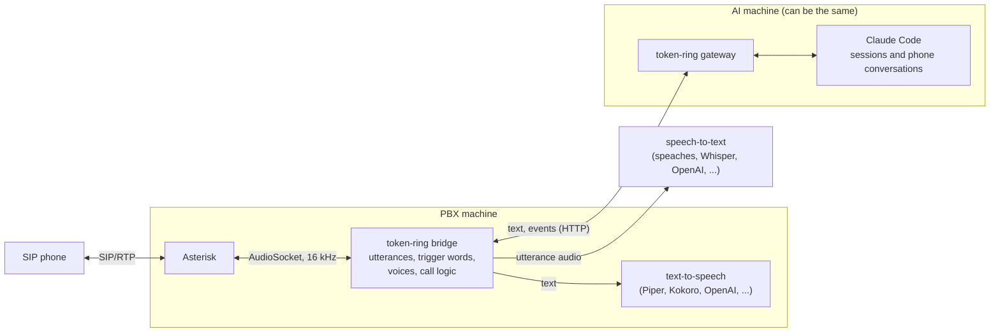

# token-ring

Talk to your AI agents on the phone. token-ring connects an Asterisk PBX to AI coding agents
such as Claude Code. Dial in and an operator answers. Ask to be put through to a session and you
can talk to it, hear its replies, answer its questions with the keypad, and interrupt it. Sessions
can ring you when they need you, or leave you voicemail.

Speech-to-text, text-to-speech and the AI are all plug-ins: use local models (Whisper, Piper,
Kokoro, Vosk), cloud APIs (OpenAI, Groq, anything OpenAI-compatible), or your own.



## What you can do on a call

| Dial | What |
|---|---|
| 200 | The AI. The operator answers: say "connect me to *session*", "new session in *session*" or "list sessions", or press 0 for a numbered list. Or just talk: the operator is an agent too |
| 201 | Voicemail: messages sessions have left you (each read in that session's voice); press 2 to leave one for a session |
| 601 | Speech echo: hear what speech-to-text made of what you said |
| 699 | Audio echo |

In a session:

- Its replies are read aloud as they're written, in that session's own voice. A soft pip means
  it's working.
- Its multiple-choice questions are read out and answered with the keypad: digits choose (or
  tick, in a multi-select), `#` finishes a multi-select, `0` repeats the question, `*` the
  instructions.
- `*` interrupts the current turn. Saying "stop" or "hang on" while it's speaking cuts the speech;
  "cancel that" also interrupts. Interrupting never cancels background work.
- Permission prompts are never answered by phone: a command read aloud can't be checked. The call
  tells you where to answer it and hangs up.
- Once you're in a session you stay there; hang up and call again for the operator.

Sessions ring you with `token-ring call "message"` and leave voicemail with `token-ring voicemail
"message"`. With `[notify]`, a new voicemail also sends a text message to your phone
(or an ntfy notification), with a reminder every hour while it's unheard. Text 200 from the phone's
chat and the operator answers by text: ask it to have a session ring you back. When you answer, you hear the message and you're talking to the session that rang.
`docs/agents.md` is what to tell your agents about it.

## Quick start (containers)

You need Docker with Compose, and a SIP phone (a softphone such as Linphone works). Reach the PBX
over your LAN or a VPN such as WireGuard rather than exposing SIP to the internet.

```sh
git clone https://github.com/abagonhishead/token-ring && cd token-ring
cp config.example.toml config.toml        # then edit it: [user], [stt], [voices], [backends]
mkdir -p secrets && openssl rand -hex 32 > secrets/token
printf '[token-ring]\nsecret = %s\nread = user\nwrite = message,command\n' "$(openssl rand -hex 24)" > secrets/manager_auth.conf
cat > secrets/pjsip_auth.conf <<'END'
[100](auth-template)
username = 100
password = (a long random password)
[101](auth-template)
username = 101
password = (another)
END
sudo chown 1000:1000 secrets/* && chmod 640 secrets/*   # the containers run as uid 1000
docker compose --profile stt up -d        # Asterisk, the bridge, Piper and speaches
```

The first build compiles Asterisk, which takes a while (about 20 minutes on a Raspberry Pi 5).
Register your phone as extension 100 at the machine's address on port 5060, and dial 601 to
check speech both ways.

Then run the gateway where your AI runs. On the same machine it can be a container (`docker
compose --profile gateway up -d`), but for Claude Code it's simplest on the host, beside your
sessions:

```sh
pipx install .                            # token-ring, token-ring-gateway, token-ring-bridge
cp secrets/token ~/.config/token-ring/token
cp systemd/token-ring-gateway.service ~/.config/systemd/user/
systemctl --user enable --now token-ring-gateway
# and give your agents docs/agents.md (as a Claude Code skill, in AGENTS.md, ...)
```

To try the phone side without an AI, set `[gateway] backend = "echo"`: its sessions say back
what you tell them.

### Your own images

The images are generic. For your own setup, build on them rather than mounting files:

```dockerfile
FROM token-ring-bridge
COPY config.toml /etc/token-ring/config.toml
```

```dockerfile
FROM token-ring-asterisk
COPY my-asterisk/ /etc/asterisk/
RUN sed -i 's/^country=.*/country=uk/' /etc/asterisk/indications.conf
```

```dockerfile
FROM token-ring-piper
RUN python -m piper.download_voices --data-dir /voices en_GB-semaine-medium
```

Secrets (the gateway token, SIP passwords) stay outside the images, as compose secrets.

## Configuration

Everything is in one TOML file; `config.example.toml` documents every setting. It's re-read
when it changes, so voices, trigger words and pronunciations can be tuned between calls (or by
asking the AI on the phone to change them).

### Speech-to-text (`[stt]`)

| engine | What |
|---|---|
| `openai` | Any server with OpenAI's transcription API: OpenAI, Groq, [speaches](https://github.com/speaches-ai/speaches), faster-whisper-server, LocalAI, whisper.cpp's server |
| `http` | POST raw 16 kHz 16-bit mono PCM, get `{"text": ...}` back. `extras/hailo-stt` is a server for the Hailo-10H accelerator |
| `command` | Run a command per utterance: WAV on stdin, text on stdout |
| `vosk` | Vosk, offline in the bridge: light, but much less accurate than Whisper |

### Text-to-speech (`[tts]`, `[voices]`)

Configure as many engines as you like and give each speaker a voice: the operator, sessions
pinned by name, and a pool the other sessions are given voices from (each session keeps the same
voice on every call). Voices can have names they introduce themselves by, and their own speaking
rates.

| type | What |
|---|---|
| `piper` | [Piper](https://github.com/OHF-Voice/piper1-gpl)'s HTTP server (`docker/piper`); fast enough on a Raspberry Pi |
| `openai` | Any server with OpenAI's speech API: OpenAI, [Kokoro-FastAPI](https://github.com/remsky/Kokoro-FastAPI), speaches, LocalAI |
| `command` | Run a command per sentence: text on stdin, WAV on stdout (espeak-ng, ...) |

### Trigger words (`[keywords]`)

Barge-in needs to hear "stop" within half a second of it being said, so a small Vosk model with
a grammar of just the trigger phrases runs inside the bridge (about 40 MB, a few percent of a
Pi 4's CPU). Switch it off with `engine = "off"`, or point `model` at another Vosk model (other
languages).

### AI backends (`[gateway] backend`)

| backend | What |
|---|---|
| `claude-code` | Claude Code. Phone conversations (the operator, new conversations) are headless `claude -p`; existing sessions are interactive Claude Code running in tmux, typed into like a terminal (so they can also be Remote Control sessions you use from the Claude app) |
| `echo` | No AI: says back what it's sent. For trying out the phone side |

## Writing plug-ins

Speech-to-text engines, text-to-speech engines, trigger-word spotters and AI backends are
classes. Name yours in the config as `"package.module:Class"`, or register it as an entry point
in `token_ring.stt`, `token_ring.tts`, `token_ring.spotters` or `token_ring.backends`, and use its
name.

- Speech-to-text: subclass `token_ring.stt.STT`, implement `transcribe(pcm) -> str`.
- Text-to-speech: subclass `token_ring.tts.TTS`, implement `synthesize(text, voice, rate, emit,
  stop)`.
- Spotter: subclass `token_ring.spotter.Spotter`, implement `feed(frame, loud)`.
- AI backend: subclass `token_ring.backends.Backend` (with `Conversation` and `Session`). The
  docstring in `src/token_ring/backends/__init__.py` describes the events and the rules every
  backend keeps; `backends/echo.py` is a complete small example, `backends/claude_code.py` the
  real thing.

### Call apps

Your own phone apps, beside the operator and voicemail: a subclass of `token_ring.bridge.Call`
(speech, the keypad, hang-up), served on its own port, with an optional background task (a
classmethod or staticmethod `background(conf)`) that can ring the phone with
`token_ring.bridge.ring_app()`, through Asterisk's manager interface (its login needs `write =
originate`). Answered calls reach the app through the `[token-ring-app]` dialplan context.

```toml
[bridge.apps.alarm]
port = 9098
class = "my_alarm:AlarmCall"     # importable in the bridge (add it to your bridge image)
```

## Security

- The AI can run commands, so only trusted extensions may dial it: `extensions.conf` lets only
  100 call 200 and 201. Keep the PBX off the open internet.
- The gateway only accepts connections from `[gateway] allowed` and checks a shared bearer token.
  Calling, voicemail and hang-up requests are only accepted from the same machine (sessions), and
  a session can ring at most once every two minutes.
- Phone conversations run with `[backends.claude-code] permission_mode` (`default` unless you
  choose otherwise). Permission prompts are never answered by phone.
- Use TLS for the gateway (`tls_cert`, `tls_key`) when the bridge is on another machine.

## Layout

| Path | What |
|---|---|
| `src/token_ring/` | The Python package: `bridge.py`, `gateway.py`, `cli.py`, and the `stt`, `tts` and `backends` plug-ins |
| `asterisk/` | A minimal Asterisk configuration (copied into the Asterisk image) |
| `docker/` | Images: `asterisk` (built from source), `bridge`, `piper`, `gateway` |
| `compose.yaml` | Everything together, with host networking |
| `docs/agents.md` | What to tell your AI agents: ringing you, voicemail, talking on the phone |
| `systemd/` | Units for running the gateway or bridge on the host instead |
| `extras/hailo-stt/` | Whisper on a Hailo-10H accelerator, as an `http` speech-to-text server |
| `tests/` | `pytest`: unit tests, and the bridge and gateway end to end with a fake Asterisk |
| `ROADMAP.md` | What's next: a web UI, encrypted calls, texting sessions, ... |

## Licence

[MPL-2.0](LICENSE). Piper, used through its own server, is GPL-3.0; Asterisk is GPL-2.0.
